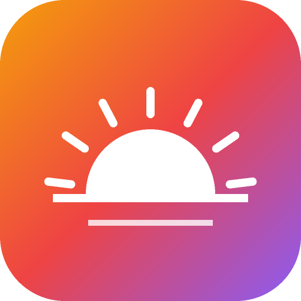
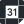

#  Alba

<p align="center">
  
</p>

**Your morning, already read.**

Alba is the app that writes your daily brief before you ever open Gmail, Slack, or your calendar. One page, one fact at a time, no need to go digging for it yourself across ten different apps.

No generic summaries, not "you have 14 unread emails". Alba reads what actually matters to you and tells you in one clear line, with the right context. One block per area of your day (work, personal projects, anything you follow), even across multiple accounts of the same app.

## What it does for you

- **The morning brief** is written on its own, refreshed several times a day, always caught up with whatever happened in the meantime.
- **A mascot that keeps you company**, a little hen living on the page, pecking around, playing with a butterfly or bee that stops by, and every now and then getting a visit from a snail that pauses to say hello.
- **Someone to ask**. Ask Alba what was in yesterday's brief, what's still pending, or just tell her "remind me to..." and she'll bring it back at the right moment, on her own.
- **LinkedIn stats on your own schedule** (weekly by default, or as often as you set it), and a Slack recap that genuinely covers every channel, not just the noisiest ones.
- **Your apps, connected once**, all gathered in one place to look at, every morning.

## Supported apps

<table width="100%">
<tr>
  <td align="center"><br>Gmail</td>
  <td align="center"><br>Calendar</td>
  <td align="center"><br>Drive</td>
  <td align="center"><br>Slack</td>
  <td align="center"><br>Google Chat</td>
  <td align="center"><br>Discord</td>
  <td align="center"><br>LinkedIn</td>
  <td align="center"><br>GitHub</td>
</tr>
<tr>
  <td align="center"><br>Notion</td>
  <td align="center"><br>Linear</td>
  <td align="center"><br>Trello</td>
  <td align="center"><br>Outlook</td>
  <td align="center"><br>YouTrack</td>
  <td align="center"><br>Jira</td>
  <td align="center"><br>Confluence</td>
  <td align="center"><br>Local folders</td>
</tr>
</table>

More sources keep being added over time.

## Your privacy first

Alba **only ever reads**. It never sends an email, never posts a message, never changes an event, never touches a document. Your credentials always stay safe on your Mac, in the Keychain. Nobody sees them, nobody reads them, not even Alba herself. The assistant only ever works on already-clean snapshots of your data, never on the originals.

## Getting started

Alba is an app for [Kiro Crew](https://kiro.dev). Install it, enable it, then connect your accounts from the **Sources** page. Your first brief arrives on its own, at the first good moment.

```bash
kirocrew app install alba
kirocrew app enable alba
```

From that moment on, your morning is already written.
